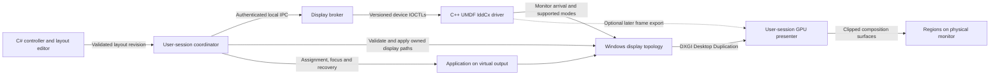

# DisplayWeave virtual display architecture draft

Status: selected architecture with an isolated feasibility prototype, October 9, 2026. The GPU presenter, cursor composition, explicit modal hardware-direct input with a cleanup guardian, owned application probe, temporary display lease fixture, and layout/protocol validation are implemented separately. The production IDD, broker and controller integration are not implemented. DisplayWeave 0.5.1 remains the installed window and monitor-hook implementation and was stopped for the recorded prototype tests. The owned x86 exclusive-projection/synthetic-input/shortcut-release sequence and an x64 guardian-stall sequence have passed, including display cleanup. Automatic focus return can still be denied; production lifecycle, hardware input, crash recovery and game compatibility remain acceptance gates. See [prototype commands, measured results, and remaining gates](projection-prototype.md).

The prototype's startup settling and bounded two-phase release are explicit limits on the preservation goal below. A release can temporarily change the physical path refresh only to match its unchanged physical target signal, while retaining the other checked physical settings. Acceptance requires the original physical topology after removing the owned virtual display; it does not mean every field stayed untouched throughout the display lifetime. This fixture policy does not establish production lifecycle reliability.

## Proposed behavior

Create a real Windows virtual display for each enabled region, run the assigned application on that display, and present its output inside the region on the physical ultrawide. Use a C++ UMDF Indirect Display Driver with IddCx, a C# controller, and a separate C++ GPU presenter. Prototype DXGI Desktop Duplication first; retain a driver frame-export interface as a later alternative if duplication cannot capture the required virtual outputs reliably.

The intended result is **fullscreen on a virtual output, displayed inside a physical-screen region**. This does not partition the physical monitor's exclusive scanout. A game must accept the virtual output, remain usable while projected, and permit capture. Universal exclusive-fullscreen compatibility is a validation goal, not an established property of IDD. DXGI allows an application to select an explicit output and can reject fullscreen because of focus, occlusion, or another fullscreen application. [Microsoft fullscreen API](https://learn.microsoft.com/en-us/windows/win32/api/dxgi/nf-dxgi-idxgiswapchain-setfullscreenstate)

Keep the physical display's resolution, refresh rate, primary status, position, desktop bounds, and taskbar unchanged. The virtual outputs are additional extended-desktop displays visible to Windows and applications; placing them outside the physical desktop rectangle does not make them private or hidden from the OS. Windows may create secondary shell surfaces according to the user's existing settings. DisplayWeave must not resize or hide those surfaces to conceal this behavior.

## What the reference projects provide

| Reference | Useful implementation | Limit for DisplayWeave |
| --- | --- | --- |
| [Microsoft IndirectDisplay sample](https://github.com/microsoft/Windows-driver-samples/tree/main/video/IndirectDisplay) | Adapter and monitor lifecycle, mode callbacks, per-monitor swap-chain processing. | A starting point for a driver, not a complete region presenter or controller protocol. |
| [Virtual Display Driver](https://github.com/VirtualDrivers/Virtual-Display-Driver/tree/d7244969b2aa8bb38e76d79505eda217996cefea) | EDID, configurable display modes, monitor creation, modern IddCx support. | Its examined frame loop leaves frame processing to the implementer; creating an output does not project it onto the ultrawide. |
| [FancyZones](https://github.com/microsoft/PowerToys/blob/7b6789c576b304c7e1eda8ce571cc1b0afd280ab/doc/devdocs/modules/fancyzones.md) | Separate layout data, zone geometry, editor, window events, and per-application history. | Window placement does not create an output for exclusive fullscreen. |
| [ihateborders](https://github.com/Z1xus/ihateborders/blob/b5bb27e1bfa03a56d976bb469536dd75e6004e69/src/window_manager.rs) and [Borderless Gaming](https://github.com/andrewmd5/Borderless-Gaming/blob/d6a541a64a2a9baf0f4aae55434a21fd9c93b8aa/BorderlessGaming.Logic/Windows/Manipulation.cs) | External style and rectangle changes for a simpler borderless mode. | Do not supply monitor virtualization or exclusive-output confinement. |
| [parsec-vdd](https://github.com/nomi-san/parsec-vdd/tree/a827c7137659b618d0a65f261ad8b2da1c74f772) | Companion application patterns for adding, removing, and maintaining displays through a driver interface. | A controller for Parsec's separate driver; its vendor-specific contract is not a generic IddCx API or an implementation of the driver. |
| [Looking Glass](https://github.com/gnif/LookingGlass/tree/cdba29f2f6bcae3ded26369fc231a067cbca3752) | Desktop Duplication capture, current IDD capture path, frame synchronization and transport. | Its Windows-guest/Linux-client architecture does not solve same-session Windows focus and input automatically. |

VDD's acquired surfaces are released after a placeholder for processing in the inspected [swap-chain loop](https://github.com/VirtualDrivers/Virtual-Display-Driver/blob/d7244969b2aa8bb38e76d79505eda217996cefea/Virtual%20Display%20Driver%20(HDR)/MttVDD/Driver.cpp#L3385). Looking Glass demonstrates an actual [IDD frame-processing path](https://github.com/gnif/LookingGlass/blob/cdba29f2f6bcae3ded26369fc231a067cbca3752/idd/LGIdd/capture/CSwapChainProcessor.cpp#L375) and a separate [shared-memory transport](https://github.com/gnif/LookingGlass/blob/cdba29f2f6bcae3ded26369fc231a067cbca3752/idd/LGIdd/transport/lgmp/CLGMPHost.cpp#L120). These are architectural references; no third-party implementation has been incorporated.

Parsec-vdd requires Parsec's separately installed `mm.dll` driver; that driver's implementation is absent from this repository. The wrapper opens the device interface and sends Parsec-specific add/remove/version/keepalive IOCTLs. An add returns a driver index, and missing keepalives eventually remove the virtual displays. Display modes are configured separately through Windows APIs. This is useful evidence for a provider boundary and driver-session lifecycle, but these commands cannot be sent to an arbitrary IDD. The wrapper's MIT license does not establish redistribution rights for the vendor's driver package. [Driver dependency](https://github.com/nomi-san/parsec-vdd/blob/a827c7137659b618d0a65f261ad8b2da1c74f772/README.md#L84-L143), [control protocol](https://github.com/nomi-san/parsec-vdd/blob/a827c7137659b618d0a65f261ad8b2da1c74f772/core/parsec-vdd.h#L236-L353), [wrapper license](https://github.com/nomi-san/parsec-vdd/blob/a827c7137659b618d0a65f261ad8b2da1c74f772/LICENSE)

Parsec-vdd's included mirror window uses GDI desktop capture and `StretchBlt`, aspect-fit scaling, and separate cursor drawing. It provides no input-routing implementation and is not evidence that the proposed GPU presenter will meet gaming latency or exclusive-fullscreen requirements. [Mirror source](https://github.com/nomi-san/parsec-vdd/blob/a827c7137659b618d0a65f261ad8b2da1c74f772/app/MirrorWindow.cs#L68-L258)

## Components and boundaries



| Component | Responsibility |
| --- | --- |
| Controller | Reuse current ruler pins, configurable pixel interval, non-overlapping cells, region identifiers, saved layouts and application rules. The eventual UI can be WinUI 3; keep the present UI during the feasibility prototype. |
| Session coordinator | Map region IDs to Windows display identities, assign eligible windows automatically, manage presenter lifecycle, observe focus/topology, and restore owned changes. Run in the interactive user session. |
| Display broker | Authenticate requests, serialize monitor changes, track leases, and communicate with the driver. Administrative rights are limited to installation and operations that actually require them. It does not capture the secure desktop. |
| IDD | Publish adapter/monitor capabilities and modes; handle monitor arrival/departure and swap-chain assignment/unassignment. No controller UI, window positioning, or game integration belongs here. |
| Presenter | Capture virtual output frames, synchronize GPU work, apply scaling/color conversion, and render within exact physical region bounds. It never loads code into an application. |

Microsoft places an IDD in the UMDF environment and prohibits windowing/GDI calls there. The interactive presenter must therefore be a separate process. User-mode execution improves isolation; it is not a guarantee that the entire graphics stack can never fail. [IDD model](https://learn.microsoft.com/en-us/windows-hardware/drivers/display/indirect-display-driver-model-overview)

The projected-display backend must not attach RegionHook to the same application. Backend selection is exclusive per application. Existing window handling remains available for applications that work without a virtual display; a failed projection must produce an honest status instead of silently switching modes.

## Layout and coordinate model

Keep three coordinate spaces explicit: physical-monitor pixels, extended-desktop source coordinates, and controller DIPs. Persist ruler positions in integer physical pixels. Convert DIPs only at the UI boundary using per-monitor DPI awareness.

Adjacent cells share the same integer edge. Use half-open rectangles `[left, right) × [top, bottom)`, reject overlaps and zero sizes, and snap interior pins to the configured pixel interval. Allow the outer monitor edge even when its size is not an exact multiple of that interval. Preserve stable region IDs when their dimensions change.

FancyZones provides useful implementation references for [cumulative shared-edge calculation](https://github.com/microsoft/PowerToys/blob/7b6789c576b304c7e1eda8ce571cc1b0afd280ab/src/modules/fancyzones/FancyZonesLib/LayoutConfigurator.cpp#L111-L138) and [monitor, virtual-desktop and layout identities](https://github.com/microsoft/PowerToys/blob/7b6789c576b304c7e1eda8ce571cc1b0afd280ab/src/modules/fancyzones/FancyZonesLib/FancyZonesDataTypes.h#L117-L151). Persist canonical pins and region IDs as the authority, with assignment records referencing a layout revision; derive rectangles on demand. FancyZones' [custom-layout refresh logic](https://github.com/microsoft/PowerToys/blob/7b6789c576b304c7e1eda8ce571cc1b0afd280ab/src/modules/fancyzones/FancyZonesLib/WorkArea.cpp#L346-L372) documents the stale-setting failure caused by duplicating layout values in applied snapshots.

Each enabled region maps to one stable monitor identity, supported source mode, and presenter destination rectangle. The preferred source size equals the region's pixel size. If the chosen mode differs, preserve aspect ratio and letterbox by default; input mapping must exclude the bars. Refresh rates use numerator/denominator pairs rather than rounded integers.

Example controller request, with illustrative dimensions:

```json
{
  "protocolVersion": 1,
  "requestId": "9a7cf05e-5270-4d14-8f98-fb30784f91f0",
  "expectedRevision": 12,
  "layoutId": "ultrawide-work",
  "gridPixels": 40,
  "physicalTargetKey": "persisted-display-path-identity",
  "regions": [
    {
      "regionId": "middle",
      "destinationPx": { "x": 2560, "y": 0, "width": 2560, "height": 2160 },
      "sourceMode": { "width": 2560, "height": 2160, "hzNumerator": 120, "hzDenominator": 1 },
      "color": "sdr",
      "enabled": true
    }
  ]
}
```

This JSON is a proposed controller contract, not an existing VDD command. The driver receives only bounded monitor/mode records, not physical destination rectangles, application paths, or arbitrary XML.

## Controller to driver protocol

Expose a DisplayWeave device interface with a versioned, fixed-width binary protocol. Implement control dispatch through the supported `EvtIddCxDeviceIoControl` callback. IddCx has no standard `ApplyRegionLayout` function; the following commands must be implemented by DisplayWeave. [IddCx client callbacks](https://learn.microsoft.com/en-us/windows-hardware/drivers/ddi/iddcx/ns-iddcx-idd_cx_client_config)

| Proposed command | Required behavior |
| --- | --- |
| `QUERY_CAPABILITIES` | Return protocol version, maximum monitor count, supported mode/color limits and available IddCx features. |
| `PREPARE_MONITORS` | Validate an expected revision and bounded desired monitor set; return a plan/token without changing topology. |
| `APPLY_MONITORS` | Apply the prepared plan serially and return observed per-monitor state. Repeated request IDs are idempotent. |
| `QUERY_STATE` | Return revision, stable monitor IDs, connector indexes, lifecycle and failure stage. |
| `RENEW_LEASE` | Keep the session's monitor set alive; reject a lease belonging to another session. |
| `RELEASE_MONITORS` | Remove only monitors owned by this installation/session, after the coordinator restores assigned windows. |

Every request includes struct size, protocol version, request ID and expected revision. Validate counts, lengths, integer multiplication and mode limits before allocating. Return API errors with their original namespace and a separate DisplayWeave stage; never reinterpret a raw result as another API's error.

Use buffered IOCTLs, a restricted device ACL, and a local IPC endpoint authenticated to the broker and owning user session. Refuse remote clients. No client-supplied pointers, executable commands or arbitrary device IDs. A UI crash must not leave an unbounded request or queue inside a driver callback.

## Applying a changed layout

1. The editor saves a draft and previews pin movement locally. It sends a revision only on Apply, not on every drag event.
2. The coordinator validates regions and capabilities, queries current display paths, and journals the prior owned configuration. It preserves all unrelated display paths.
3. The broker prepares and then applies the desired monitor set. The driver uses stable connector/container identities and announces new monitors through `IddCxMonitorCreate` and `IddCxMonitorArrival`. Retain old monitors until assignments can migrate; if the monitor limit requires an early removal, identify that disruption during preparation.
4. The coordinator waits for Windows enumeration, matches stable identities rather than display numbers, and constructs the desired extended topology. It validates with `SetDisplayConfig`, then applies supplied paths temporarily. It does not use a broad topology reset or permit Windows to alter supplied physical modes as a fallback.
5. The presenter resolves each virtual output and starts capture. Mode/topology changes recreate capture resources. An application moves only after its destination is available, and projection becomes active only after the first valid frame.
6. The coordinator verifies physical-display invariants, migrates assignments, retires obsolete owned monitors with `IddCxMonitorDeparture`, verifies the final topology and persists the successful revision. Failures roll back owned changes and report the failing stage. Windows monitor enumeration and display-mode changes are asynchronous; this is a compensating transaction, not a single atomic OS operation.

`SetDisplayConfig` supports validation and temporary application of supplied paths. Use complete physical modes and omit `SDC_ALLOW_CHANGES`; if preserving them is impossible, fail the operation. Re-read topology before rollback so a user's intervening monitor change is not overwritten. [Microsoft display configuration API](https://learn.microsoft.com/en-us/windows/win32/api/winuser/nf-winuser-setdisplayconfig)

`IddCxMonitorUpdateModes` updates target modes; it is not a universal way to replace monitor-descriptor capabilities. Initially advertise a bounded mode set. Apply supported size changes within that set; for a new arbitrary size, use a controlled departure/recreation with updated descriptors unless a dynamic descriptor strategy has been validated. Keep showing the prior frame scaled while preparing a resize. Defer disruptive changes while an application is fullscreen and explain when re-entering fullscreen is necessary. [Mode updates](https://learn.microsoft.com/en-us/windows-hardware/drivers/ddi/iddcx/ns-iddcx-idarg_in_updatemodes)

## Frame capture and projection

Desktop Duplication does not replace the driver's swap-chain responsibilities. Each assigned monitor needs a worker that binds a device for the supplied render-adapter LUID, acquires and releases frames, and calls `IddCxSwapChainFinishedProcessingFrame` promptly even when frames are discarded. Handle new-frame and cancellation events, and stop the worker and release resources on unassignment or device shutdown. Never block this loop waiting for the presenter; IddCx monitors stalled frame processing. [Driver sample](https://github.com/microsoft/Windows-driver-samples/tree/main/video/IndirectDisplay), [IddCx frame watchdog](https://learn.microsoft.com/en-us/windows-hardware/drivers/display/indirect-display-debugging)

The first backend uses one capture worker per active virtual output and a D3D11 device on that output's adapter. Try `IDXGIOutput5::DuplicateOutput1` with a tested format list, then use ordinary duplication only for an explicitly SDR fallback. Discovery must prove that the virtual output exposes a usable duplication interface; IDD installation alone does not establish that. [Duplication creation and formats](https://learn.microsoft.com/en-us/windows/win32/api/dxgi1_5/nf-dxgi1_5-idxgioutput5-duplicateoutput1)

Acquire with a finite timeout, copy a valid surface into a presenter-owned GPU resource, release the acquired frame, and present the newest completed frame. Use a small bounded texture pool and GPU synchronization; drop superseded frames rather than accumulating latency. Coordinate ownership so no surface is reused while capture or presentation still accesses it. Render only from virtual sources to avoid feedback from capturing the presenter itself.

Use non-activating borderless windows on the physical monitor with exact destination clipping and a D3D/DirectComposition presentation path. Respect the existing taskbar policy and z-order; do not change global work-area settings. Match source and destination dimensions when possible. Handle rotation, cursor composition, scaling and letterboxing explicitly. [Desktop Duplication behavior](https://learn.microsoft.com/en-us/windows/win32/direct3ddxgi/desktop-dup-api)

Treat `DXGI_ERROR_ACCESS_LOST` as a request to release and recreate duplication after a topology/mode transition. On session lock, disconnect or unavailable capture, stop input forwarding and show an unavailable state; do not elevate capture to access another desktop. [Frame acquisition and recovery](https://learn.microsoft.com/en-us/windows/win32/api/dxgi1_2/nf-dxgi1_2-idxgioutputduplication-acquirenextframe)

An optional later backend copies IddCx-acquired frames into exportable resources and sends a bounded stream to the session presenter. Prove adapter compatibility, Session 0-to-interactive-session resource sharing and permissions, fences and resource lifetime before choosing this path. A presenter must never retain an IddCx-owned buffer across release. Cross-adapter transfers may require an additional copy or a slower transport. Do not describe either path as zero-copy or zero-latency without measurement.

## Input and exclusive fullscreen feasibility

Input is a release gate. A projection window is not the game's window, and Windows does not give each region an independent foreground application. Keeping the presenter non-activating helps preserve focus but does not automatically route physical-region clicks to a window on a different desktop coordinate range.

Prototype an explicit enter/leave interaction mode with a reliable escape shortcut. On a deliberate user action, focus the target subject to normal Windows foreground rules and place the single OS cursor on the virtual output. Keep the projector display-only and show the captured cursor in its physical region. Test hardware mouse and keyboard input reaching the game directly before considering synthesis. Selecting another physical application must be allowed to change focus and possibly end fullscreen; never repeatedly steal focus back. Absolute pointer mapping, capture clipping, touchscreen/tablet input and return to the physical desktop require separate validation. [Mouse routing](https://learn.microsoft.com/en-us/windows/win32/inputdev/about-mouse-input), [non-activating windows](https://learn.microsoft.com/en-us/windows/win32/winmsg/extended-window-styles)

For an absolute pointer inside the displayed image, the geometry is `sourceX = virtualLeft + (pointerX - imageLeft) * sourceWidth / imageWidth`, with the corresponding Y calculation. This formula defines coordinates only; it does not establish a compatible delivery mechanism. `SendInput` feeds the system input stream and is subject to integrity restrictions. It is not a per-window input channel or a guarantee for games using raw input. Do not rely on posted mouse messages, focus stealing or input synthesis as a universal solution. [Microsoft input API](https://learn.microsoft.com/en-us/windows/win32/api/winuser/nf-winuser-sendinput)

Automatic assignment can place eligible windowed applications on a selected virtual output and remember the region. It cannot force every already-exclusive game to change an explicit output choice externally. Preserve a manual display-selection path for those applications. Test output selection, focus loss, Alt+Tab, menus, cursor confinement, controller input, and return to the desktop before describing an application as supported.

## Performance and color requirements

Advertised refresh rate, delivered capture rate and physical presentation rate are separate measurements. Start with SDR at 60 Hz, then test 120/144 Hz and the physical monitor's supported maximum. A 500 Hz mode advertises a 2 ms interval; it does not prove that rendering, capture, composition and scanout complete at that rate. The physical panel remains the limit on visible updates.

Record delivered FPS, dropped frames, GPU utilization, memory/copy bandwidth and p50/p95/p99 frame age. Also measure end-to-end input-to-visible response against the same application running directly on the physical display. Internal timestamps alone cannot measure final scanout latency. A proposed first performance gate is p95 projection overhead below one physical refresh interval on the reference GPU; this is an acceptance target, not a result.

HDR requires a verified chain from advertised display capability through captured format/color space, tone mapping, presenter swap chain and physical output. Ordinary `DuplicateOutput` converts to BGRA; `DuplicateOutput1` can preserve supported higher-color formats. Looking Glass's current IDD path also handles color metadata through newer IddCx APIs. Neither fact establishes HDR10+ dynamic-metadata support in DisplayWeave. Keep HDR off in the first prototype and distinguish HDR10, scRGB and HDR10+ in later capability reports. [Capture format support](https://learn.microsoft.com/en-us/windows/win32/api/dxgi1_5/nf-dxgi1_5-idxgioutput5-duplicateoutput1)

## Recovery and delivery

Keep a journal of owned monitor identities, successful layout revision and saved application placement. On presenter loss, release input capture immediately and attempt one bounded restart before restoring owned application windows. On broker loss or lease expiry, retire owned virtual monitors safely. Resume after sleep or GPU reset by re-enumerating identities and recreating device resources; stale handles and display numbers are invalid.

Never change the physical monitor into a virtual region, resize Explorer/taskbars, or make a virtual display primary to coerce a game. Recovery must leave the real screen usable even if monitor removal or application restoration fails. On shutdown restore windows before monitor departure where possible; on next launch reconcile the journal with actual OS state.

A modified driver needs its own package identity, INF/catalog and supported signing/distribution process. A signature on another project's release does not cover our rebuilt binary. Development signing belongs on an isolated test system; the user's normal PC should keep its existing security settings. Package controller, presenter and driver versions separately with explicit protocol compatibility and rollback.

Use Microsoft/VDD permissively licensed code only with the required notices if incorporated. The examined ihateborders, Borderless Gaming and Looking Glass repositories use GPL licenses; treat them as behavioral references unless a deliberate distribution/license decision is made. Parsec driver redistribution must be assessed separately from the license of its controller wrapper.

## Staged implementation and acceptance

| Stage | Deliverable and pass condition |
| --- | --- |
| 1 Capture and input experiment | First use two existing outputs on a test system, an owned D3D application and a non-activating projector. Verify direct hardware input, focus, cursor/escape recovery and fullscreen state. Then repeat against a candidate IDD output to establish its capture/fullscreen support. Passing the physical-output test does not prove the virtual-output test. |
| 2 Driver control | Implement the secured protocol and one-monitor lifecycle. Test idempotency, stale revisions, malformed requests, session isolation, crash cleanup and controlled signing/install/rollback. |
| 3 Region integration | Connect existing ruler layouts and automatic assignment. Verify DPI, negative monitor coordinates, non-overlap, region resize, removal, saved layout and startup behavior. |
| 4 Performance and recovery | Test multiple outputs, high refresh, GPU/device loss, sleep, lock, hot-plug, controller/presenter/broker crashes, and preservation of unrelated display paths. |
| 5 Application compatibility | Test application-specific output selection and input on the completed backend. Keep exclusive fullscreen, borderless and windowed results separate. Add HDR only after SDR behavior passes. |

Stage 1 must demonstrate both usable input and continuous projection while the owned application's requested fullscreen state is active. A fullscreen-looking image alone is insufficient. D3D11 and D3D12 probes should report their own swap-chain state and output identity; other graphics APIs need separate coverage. Neither this design nor the 0.5.1 diagnostic correction establishes Diablo IV compatibility or publisher approval.

The next implementation step is the one-output feasibility experiment, before a UI rewrite or a full custom driver. Existing DisplayWeave behavior remains the supported path until that gate passes.
